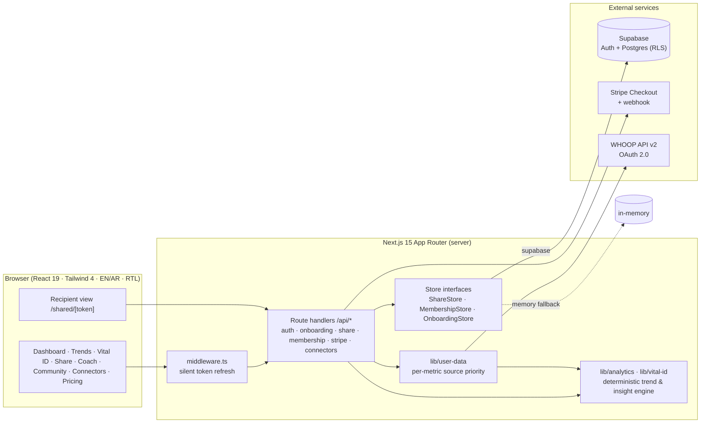

<p align="center">
  
</p>

<h1 align="center">Vital ID</h1>

<p align="center">
  <b>Your health identity — understood at a glance, shared on your terms.</b><br/>
  A bilingual (English / العربية) health-credential web app: connect your wearables, see what is happening and how it is changing,<br/>
  then share <i>only</i> what you choose, through a temporary, revocable link or QR code.
</p>

<p align="center">
  
  
  
  
  
  
  
  <a href="https://github.com/SilviaMogas/FISHTANK/actions/workflows/ci.yml"></a>
  
</p>

<p align="center">
  <a href="docs/Vital_ID_Organized_Deck.pdf"><b>Pitch deck (PDF)</b></a> ·
  <a href="#-demo-in-60-seconds">Demo in 60 seconds</a> ·
  <a href="#-architecture">Architecture</a> ·
  <a href="#-security--privacy-model">Security model</a> ·
  <a href="#-run-it-locally">Run it locally</a>
</p>

---

## The problem

Health data is scattered across rings, watches, nutrition apps and medical records. When it matters —
an emergency, a doctor visit, travel, an insurer, a caregiver — people either share **everything**
(a screenshot of a whole app) or **nothing**. There is no simple, trusted way to say
*"show this person these three facts, for the next hour, and then forget them."*

## The solution

**Vital ID** turns raw signals into a portable **health credential**:

| Question | Screen | What it does |
|---|---|---|
| **What is happening?** | Dashboard | Recovery, sleep, HRV, resting HR and activity, each with a status (stable / improving / declining / unusual) and its data source. |
| **How is it changing?** | Trends | 7-day / 30-day charts against a personal baseline. |
| **What does it mean?** | Insights + Coach | Deterministic, explainable insights and goal-based recommendations (no black box). |
| **What do I want to share?** | Vital ID + Share | Field-level selective disclosure → temporary link + QR → read-only recipient view → one-tap revoke. |

Golden path: **Dashboard → Trends → Insight → Vital ID → Share → Link / QR → Recipient view → Revoke**

## Feature highlights

- **Selective sharing, by design** — pick a purpose (Emergency, Doctor, Travel, Caregiver, Custom); fields are pre-selected but editable. Only those fields are copied server-side.
- **Temporary + revocable** — 15 min / 1 h / 24 h expiry; revoke instantly; the recipient page re-polls and flips to *"expired or revoked"* live.
- **Send to UAE insurers** — Daman, GIG Gulf (AXA), Sukoon, ADNIC, Orient, Bupa, Allianz Care, Cigna, MetLife.
- **Real wearable integration** — **WHOOP OAuth 2.0 (API v2)** with rotating refresh tokens and daily sync; catalogue of 16 providers (Oura, Garmin, Fitbit, Apple Health, MyFitnessPal, Strava, Calm, …) ready for the same flow.
- **Bilingual, RTL-first** — full English / Arabic UI with right-to-left layout switching.
- **Real accounts** — Supabase Auth (email + password) with httpOnly cookie sessions and silent token refresh in middleware.
- **Membership tiers** — Free / Plus / Pro with feature gating, powered by **Stripe Checkout** (live mode, server-verified, webhook-confirmed).
- **Guided onboarding** — goals, providers, baseline metrics and profile photo; persisted per user.
- **Coach & Community** — goal-based recommendations and hobby-based community matching.
- **A friendly face** — an animated broccoli mascot and "produce crew" that react to your data.
- **Try-it-now demo** — "Login as Fatima" loads a deterministic, fully synthetic demo profile.

## Demo in 60 seconds

```bash
npm install
npm run dev            # → http://localhost:3000
```

1. Open `/` → splash → **Login as Fatima**.
2. **Dashboard** — today's signals and insight.  **Trends** — switch 7D / 30D.
3. **Vital ID** — the health credential card.
4. **Share** → purpose *Doctor* → expiry *1 h* → **Generate secure link** → scan the QR or open the link in another tab.
5. Back on **Share**, click **Revoke** — within ~10 s the recipient tab shows *expired or revoked*.
6. Toggle **العربية** to see the full RTL experience.

> No keys needed: without env vars the app runs on in-memory stores with the deterministic demo dataset.

## Architecture



**Data-source priority** (per metric, per user — `lib/user-data.ts`):
`WHOOP (real API) → provider sample data → manual onboarding baseline → empty state`.
Every number on screen is labelled with where it came from.

**Pluggable persistence** — every store (`ShareStore`, `MembershipStore`, `OnboardingStore`) has a
`memory` and a `supabase` implementation behind one interface, selected by env
(`SHARE_STORE`, `MEMBERSHIP_STORE`; empty = auto). The UI and API never know which one is running.

## Security & privacy model

| Concern | How it is handled |
|---|---|
| Over-sharing | Server copies **only** the selected top-level fields into the share snapshot; history series are stripped. |
| Link leakage | Links carry an opaque random id (`crypto.randomBytes`) — the URL and QR contain **no health data**. |
| Dead links | Missing, expired **and** revoked shares all return `410 unavailable`; payloads are served `Cache-Control: no-store`. |
| Database access | Every `vital_id_*` table has **RLS enabled with no policies** — anon/publishable keys get nothing; only the server-side secret key can read/write. |
| Secrets | Server-only modules are guarded with `import "server-only"`; no secret is ever bundled to the client. |
| Sessions | Supabase access/refresh tokens in **httpOnly**, `SameSite=Lax`, `Secure` (prod) cookies; middleware rolls them over before expiry. |
| Payments | Plans are activated **only** after server-side verification of the Checkout Session (and webhook), with the expected price asserted. |
| Third-party tokens | WHOOP refresh tokens rotate; the new pair is persisted before use; failures surface as "Reconnect". |
| Demo data | All demo data is fictional / synthetic. |

## Tech stack & infrastructure

| Layer | Technology |
|---|---|
| Framework | **Next.js 15** (App Router, Route Handlers, Middleware), **React 19** |
| Language | **TypeScript 5** (strict), shared contracts in `types/` |
| Styling | **Tailwind CSS 4**, custom design system (see `docs/DESIGN_PASS.md`) |
| i18n | Custom `LocaleProvider` + `lib/i18n.ts` — English & Arabic, LTR/RTL |
| Auth | **Supabase Auth** (email + password), httpOnly cookie sessions |
| Database | **Supabase Postgres** with RLS — 8 SQL migrations in `supabase/migrations/` |
| Payments | **Stripe** (Checkout, webhooks, server-side verification) |
| Integrations | **WHOOP** OAuth 2.0 / API v2 (recovery, sleep, cycles, workouts, body) |
| Sharing | Temporary tokens, QR codes via `qrcode.react` |
| Quality | ESLint 9 + `tsc --noEmit` + production build, run in **GitHub Actions CI** |
| Hosting | Vercel-ready (no custom server) |

### Database schema (`supabase/migrations/`)

| Table | Purpose |
|---|---|
| `vital_id_shares` | Temporary selective shares (token, expiry, revoked, selected fields, snapshot) |
| `vital_id_memberships` | Plan per user, Stripe session / payment references |
| `vital_id_onboarding` | Goals, chosen providers, baseline metrics, profile photo |
| `vital_id_whoop_connections` / `vital_id_whoop_daily` | WHOOP tokens and daily mapped metrics |
| `vital_id_profiles` / `vital_id_metrics` / `vital_id_events` | Optional extension tables |

### API surface

| Area | Routes |
|---|---|
| Auth | `POST /api/auth/signup` · `POST /api/auth/signin` · `POST /api/auth/signout` · `GET /api/auth/me` |
| Onboarding | `GET / PUT /api/onboarding` |
| Sharing | `POST / GET /api/share` · `GET /api/share/:id` · `POST /api/share/:id/revoke` · `POST /api/share/:id/send` · `POST /api/share/reset` · `GET /api/share/health` |
| Membership | `GET /api/membership` · `POST /api/membership/choose-free` · `POST /api/membership/reset` |
| Payments | `POST /api/stripe/checkout` · `POST /api/stripe/webhook` |
| WHOOP | `/api/connectors/whoop/{connect, callback, status, sync, disconnect}` |

## Project structure

```
app/
  (core)/            Dashboard, Trends, Vital ID, Coach, Community, Connectors
  api/               Route handlers (auth, onboarding, share, membership, stripe, connectors)
  share/  shared/[token]/   Owner share flow · read-only recipient view
  onboarding/ signin/ signup/ pricing/ checkout/ welcome/
components/          UI by feature (dashboard, trends, vital-id, share, coach, mascot, …)
lib/
  analytics.ts       Deterministic baseline / trend / insight engine (pure functions)
  vital-id.ts        Snapshot builder — single entry point for core contracts
  user-data.ts       Per-user data-source priority
  sharing.ts         Share payloads, purpose presets
  share-storage/  membership/  onboarding/   Store interfaces + memory / Supabase backends
  connectors/whoop/  OAuth, client, sync, mapping
  stripe/  supabase/  auth/
supabase/migrations/ SQL schema with RLS
scripts/             Smoke tests, Stripe setup, WHOOP mock server
docs/                Build plan, coordination, sharing, billing, connectors, Supabase, design, deck
```

## Run it locally

Requirements: **Node.js 20+** and npm.

```bash
git clone https://github.com/SilviaMogas/FISHTANK.git
cd FISHTANK
npm install
cp .env.example .env.local   # optional — everything works without it (demo mode)
npm run dev                  # http://localhost:3000
```

| Command | What it does |
|---|---|
| `npm run dev` | Development server |
| `npm run build && npm start` | Production build & server |
| `npm run lint` | ESLint |
| `npx tsc --noEmit -p .` | Type check |
| `node scripts/supabase-smoke.mjs` | Share-store smoke test against Supabase |
| `node scripts/membership-smoke.mjs` | Membership-store smoke test |
| `node scripts/whoop-mock-server.mjs` | Local WHOOP OAuth/API mock for end-to-end tests |
| `node scripts/stripe-setup.mjs` | Creates the Stripe demo products / prices |

### Optional integrations (`.env.local`)

| Variables | Enables | Docs |
|---|---|---|
| `SUPABASE_URL`, `SUPABASE_SECRET_KEY` | Real accounts + persistent storage | [`docs/SUPABASE.md`](docs/SUPABASE.md) |
| `STRIPE_SECRET_KEY`, `STRIPE_WEBHOOK_SECRET`, `STRIPE_{PLUS,PRO}_DEMO_PRICE_ID` | Paid plans | [`docs/BILLING.md`](docs/BILLING.md) |
| `WHOOP_CLIENT_ID`, `WHOOP_CLIENT_SECRET` | Live WHOOP connection | [`docs/CONNECTORS.md`](docs/CONNECTORS.md) |

## How it was built

Vital ID was built during a hackathon by **Silvia Mogas** orchestrating several autonomous
**Devin** AI engineers working in parallel on separate branches, coordinated through written
contracts:

- **Chat A — Core experience:** app foundation, EN/AR + RTL, dashboard, trends, analytics, Vital ID card.
- **Chat B — Secure sharing:** selective disclosure, tokens, expiry, QR, recipient view, revoke.
- **Chat C — Backend:** Supabase schema, RLS, pluggable stores.
- Follow-ups: Supabase Auth, onboarding, Stripe membership, WHOOP OAuth, Coach, Community, design pass.

Shared TypeScript contracts (`types/`, `lib/vital-id.ts`) let agents integrate without stepping on each other.
Everything landed through reviewed pull requests with lint + type-check + build gates.

| Document | Content |
|---|---|
| [`docs/BUILD_PLAN.md`](docs/BUILD_PLAN.md) | MVP scope, golden path, work split |
| [`docs/COORDINATION.md`](docs/COORDINATION.md) | Multi-agent coordination contract |
| [`docs/SHARING.md`](docs/SHARING.md) | Sharing security model & API |
| [`docs/SUPABASE.md`](docs/SUPABASE.md) | Database, RLS, store switching |
| [`docs/BILLING.md`](docs/BILLING.md) | Stripe membership flow |
| [`docs/CONNECTORS.md`](docs/CONNECTORS.md) | WHOOP integration & data mapping |
| [`docs/DESIGN_PASS.md`](docs/DESIGN_PASS.md) | Visual system, mascot, splash |
| [`docs/Vital_ID_Organized_Deck.pdf`](docs/Vital_ID_Organized_Deck.pdf) | Pitch deck |

## License

[MIT](LICENSE) © Silvia Mogas
